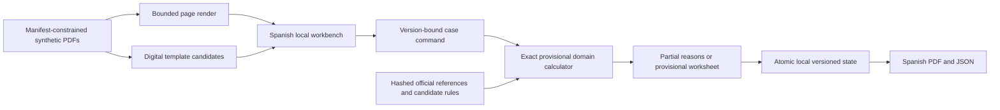

# C001 working development slice

**22 October 2026. Implemented locally; provisional tax treatment, professional QA pending.** [ADR 0004](../decisions/0004-development-before-tax-review.md) moves independent review to final QA. The full product scope remains unchanged.

## Run and inspect

```sh
uv sync --locked
PYTHONPATH=src uv run --locked python -m renta_assistant --port 8020
```

Open `http://127.0.0.1:8020/`. Poppler `pdftoppm` must already be available for rendering. The application binds loopback only, serves the fixed C001 synthetic inventory and rejects any profile other than `local-synthetic`. It is a development adapter, not the production HTTP/authentication deployment.

1. Inspect original page images beside editable transcriptions. The prefill is a narrow digital certificate-template baseline, explicitly labelled as such; no AI extraction or OCR inference occurs. Missing/ambiguous text stays empty and unconfirmed. Manual fact entry and whole-page evidence anchors remain explicit.
2. Confirm the displayed values, including zeroes, against source pages. Source ID and page accompany every used fact.
3. Explicitly declare the initial supported circumstances, including all sources/payers and habitual-home ownership. These are manual supplements to the deliberately sparse source statement, not inferred negatives.
4. Save. Missing/unconfirmed facts, incomplete coverage and unsupported treatments produce a persisted partial review without a whole-return result. Complete supported inputs produce provisional stage/field calculations.
5. Confirm the partial draft separately before comparison. Without draft confirmation, calculation can proceed but there are no proposed changes against invented prior values.
6. Inspect the worksheet, comparisons and local audit/diagnostic counters; download a Spanish PDF or structured JSON packet. The owner/professional has not approved these results merely because UI verification was exercised.

## Calculation envelope and assumptions

The executable branch covers 2025 Balearic ordinary individual cash employment, one payer, age 18-64 at year end, gross bank interest attributed 100%, no dependants/disability, no other income/assets/reliefs/history, and an owned habitual home. The Article-20 income test uses salary less Social Security **before** the annual other-expense allowance. If that income is below 19,747.50 EUR, or gross salary below the 2025 credit ceiling, the initial engine blocks rather than inventing a zero reduction/credit. Nonzero in-kind/employer pension amounts and other unimplemented branches block as well.

The staged calculation applies the 2,000 EUR annual employment allowance, separates general/savings bases and state/Balearic components, calculates tax on the applicable minima, and reconciles evidenced withholding. Ordinary account fees remain separate from gross interest. This is a source-derived development interpretation, not professional sign-off. C001 with all displayed facts confirmed and the explicit fictional coverage declarations yields **185.50 EUR provisionally payable**. The component/field assertions in tests are authored engineering expectations, not independent labels or held-out accuracy evidence.

Money uses exact decimal text and Decimal arithmetic. Cent results use disclosed `ROUND_HALF_UP`; average rates are truncated to two decimals. Stage rounding is still part of RQ-08 for final professional QA. The assumption is included in the UI/PDF/JSON. The current C001 monetary products do not depend on a half-cent tie. No tax fact is silently filled with a default.

## Implemented boundaries



The domain has no provider/document/storage I/O. Application orchestration depends on source/state protocols; local infrastructure implements those ports. A future hosted adapter can replace storage/identity while retaining the core. The standard-library HTTP server is explicitly limited to synthetic local use; PostgreSQL, object storage and an authenticated production HTTP adapter remain future work.

- Fixed inventory and path/symlink checks reject cross-case/arbitrary file access. Sources and rules are hash/version checked; policy changes invalidate export until recalculation.
- Rendering is a bounded subprocess over the public fixture inventory, with size/page/pixel/time checks and a small original-hash-keyed in-memory cache. This is not an OS sandbox for arbitrary uploads.
- Host/Origin/CSRF checks protect local commands; CSP, no-store and no-sniff headers apply. Source text enters the UI as text, and PDF paragraphs are escaped.
- Local JSON writes are atomic, with file-lock/version checks across writers, request idempotency and append-only application events. A corrupted/stale source state is not silently discarded. This adapter does not implement durable background jobs or the future deletion/backup contract.
- Routine diagnostics expose only finite operation counts, elapsed command time, version and zero provider calls. Full OpenTelemetry spans, durable jobs, cloud operation and model-quality evaluation remain unimplemented.
- State and QA artifacts stay under ignored `.runtime`; only public code/sources enter Git. No private reference or expected-answer files are accessed.

## Next implementation steps

Expand the deterministic coverage with source-based regressions, starting with multiple employers and the low-income branches, then families/reliefs and both required regional deductions. Build the visual/AI adapter and offline comparison/scorer boundary while keeping live inference disabled until separately bounded. Professional QA reviews the working product and its provisional interpretations at the end, generating defects/regressions before validated release claims.
