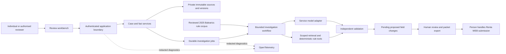

# High level design

**Proposed, 21 October 2026.** This is the first architecture hypothesis for the agreed review packet. The application and cloud components are not implemented.

Start with one modular Python core, explicit typed domain/application interfaces and local adapters. The first retrieval baseline can be deterministic; a bounded LangGraph workflow or a higher-level harness must earn its cost through comparison. Model, extraction, persistence and cloud choices remain candidates in [ADR 0002](../decisions/0002-stack-and-reuse.md).

The rule corpus and private evidence are separate stores. Retrieval receives authorised case identity from trusted application code and filters rules by tax year, region and supported treatment. The model cannot choose another taxpayer, invoke arbitrary SQL, fetch arbitrary URLs or create permissions.

Local use and later hosted environments share domain and review logic. The public portfolio uses synthetic recorded outputs and no model connection. AWS is the preferred hosted candidate, GCP the fallback; adapt one provider after cost/runtime validation rather than implementing two stacks.
