# High level design

**Proposed, 21 October 2026.** Aligned with product baseline 1.0 and the [draft detailed tax specification](../requirements/tax-2025.md). The application, tax engine and cloud components are not implemented. Rule transcriptions and applicability remain pending independent review.

The deterministic engine derives the full supported return from confirmed source facts, independently of supplied AEAT totals. AI assists interpretation, questions and explanation; it cannot supply authoritative rates, arithmetic, coverage or approval.

```mermaid
flowchart LR
    U[Authenticated case owner] --> UI[Spanish guided workbench]
    UI --> API[Authenticated application boundary]
    API --> INTAKE[PDF and image intake]
    INTAKE --> PRIVATE[Private immutable sources and versions]
    INTAKE --> PAGES[Versioned PDF pages and image evidence]
    PAGES --> EXTRACT[Visual fact extraction and confirmation]
    EXTRACT --> CASE[Versioned case and confirmed fact services]
    API --> CASE
    CASE --> PRIVATE[Private immutable sources and versions]
    CASE --> JOB[Durable investigation jobs]
    CASE --> COVER[Material coverage and completeness gate]
    COVER --> ENGINE[Deterministic staged tax engine]
    COVER -. incomplete or unsupported .-> PARTIAL[Partial findings and specific questions]
    PINS[Pinned official sources] --> SIGNOFF[Independent rule and applicability review]
    SIGNOFF --> CORPUS[Approved year-specific rule set]
    CORPUS --> ENGINE
    ENGINE --> WORKSHEET[Intermediate fields and full result when covered]
    DRAFT[Optional supplied AEAT draft] --> DIFF[Contextual field comparison]
    WORKSHEET --> DIFF
    JOB --> HARNESS[Bounded investigation workflow]
    CORPUS --> HARNESS
    HARNESS --> TOOLS[Scoped retrieval and deterministic rule tools]
    HARNESS --> MODEL[Bounded service model adapter]
    EXTRACT -. authorised inference .-> MODEL
    TOOLS --> ENGINE
    TOOLS --> VALIDATE[Code-enforced output validation]
    MODEL --> VALIDATE
    DIFF --> VALIDATE
    VALIDATE --> PENDING[Pending proposed field changes]
    PENDING --> REVIEW[Human review and packet export]
    PARTIAL --> REVIEW
    REVIEW --> MANUAL[Person handles Renta WEB submission]
    REVIEW --> PROFESSIONAL[Owner shares packet for professional feedback]
    API -. redacted diagnostics .-> OTEL[OpenTelemetry]
    JOB -. redacted diagnostics .-> OTEL
```

The [17-stage requirements map](../../data/rules/2025/calculation-stages.json) separates income, integration, pension relief, bases, state/regional minima and scales, deductions, withholding, family credits, result and comparison. Unknown material facts, unvalidated branches or unapproved rules block a complete result; they do not become zero. The workflow can still export a clearly incomplete packet. Without a draft, it can organise evidence and calculate a supported return, but cannot invent prior draft values or field changes.

Independent evaluation expectations are outside this application graph: the separate scorer compares immutable run outputs with reviewer-approved labels. No runtime retrieval or provider context can access `evals/expected`, construction metadata or reviewer templates. Structural source/fixture checks are implemented development tools; they are not the application's semantic validator or tax engine.

Start with one modular Python core, explicit typed domain/application interfaces and local adapters. The first retrieval baseline can be deterministic; a bounded LangGraph workflow or a higher-level harness must earn its cost through comparison. Model, extraction, persistence and cloud choices remain candidates in [ADR 0002](../decisions/0002-stack-and-reuse.md).

The rule corpus and private evidence are separate stores. Retrieval receives authorised case identity from trusted application code and filters rules by tax year, region and supported treatment. The model cannot choose another taxpayer, invoke arbitrary SQL, fetch arbitrary URLs or create permissions.

Local use and later hosted environments share domain and review logic. The public portfolio uses synthetic recorded outputs and no model connection. AWS is the preferred hosted candidate, GCP the fallback; adapt one provider after cost/runtime validation rather than implementing two stacks.

## Visual evidence boundary

The owner selected image-based PDF understanding and standalone screenshot/image support for the first usable version. Preserve originals and versioned page images; render digital/scanned PDFs and decode admitted image formats through bounded adapters. A page-image read need not depend on embedded text. Text/OCR may aid indexing or comparison. See [ADR 0003](../decisions/0003-visual-document-evidence.md).

Visual extraction and later investigation share the same explicit inference authorisation/accounting boundary. Rendering is deterministic local work; model interpretation consumes separately bounded provider resources and runs outside transactions. No image-provider compatibility, rendering implementation or model superiority is verified yet.
