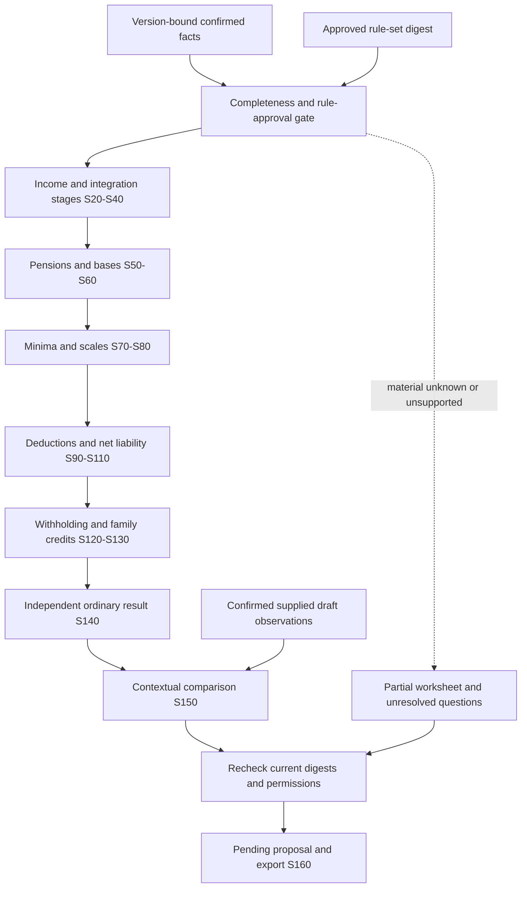

# Low level design

**Proposed interfaces, not implemented schemas.** Aligned with the approved product baseline and [2025 source-derived requirements](../requirements/tax-2025.md); exact tax conditions, rounding and independent expectations are still under review.

Independent calculation derives intermediate values from confirmed facts, never from supplied draft totals. The [stage map](../../data/rules/2025/calculation-stages.json), [field map](../../data/rules/2025/aeat-fields.json) and [rule register](../../data/rules/2025/rule-register.json) are draft contracts, not executable rules.

## Core records

| Record | Required identity and state |
|---|---|
| Case | Authorised owner/workspace, tax year 2025, jurisdiction, profile, state and version |
| Source | Private immutable original, content hash, detected media type, parser/decoder version and admission result |
| Page image | Source hash, physical page index, image hash, dimensions, renderer version/configuration and any rotation/crop transform |
| Evidence anchor | Source/page-image identity and valid region or whole-page reference; text spans when available, with coordinate convention and transform mapping |
| Fact | Visible transcription and normalised typed value, unit/period, text/image anchors, legibility and confirmation state, and conflicting alternatives |
| Rule | Supported treatment, year/region, official source and version, prerequisites and exact calculation/rounding |
| Coverage assessment | Versioned material-branch inventory; supported and established, established inapplicable, unresolved or unsupported; evidence and blocking consequences |
| Calculation run | Confirmed fact-set digest, source/case/rule/engine versions, stage outcomes, incomplete reasons and immutable worksheet digest |
| Stage result | Stage ID, exact typed inputs/outputs, applied rule IDs, decimal operation/rounding record, contextual field IDs and upstream digests |
| Draft observation | Supplied source/page, tax year, person/payer/annual/annex context, field ID and confirmed transcribed value; never a trusted calculation input |
| Investigation | Input snapshot, workflow/model/prompt/schema versions, bounded attempts and outcome |
| Proposed change | Draft field, prior/new value, fact/rule references, calculation, source digest and pending status |
| Review event | Reviewer authority, exact proposal digest, decision, idempotency key, timestamp and new case version |

## Execution contract

1. Authorise the case and stage bounded PDFs/images. Detect and admit formats, preserve original bytes/hash, render PDF pages or decode standalone images with size/page/pixel/time limits, and retain versioned derivatives. Image-only PDFs need no embedded text. Run decoding/rendering in an appropriately isolated resource-limited process; a child process alone is not an OS sandbox.
2. Propose facts from visual evidence; retain readable transcriptions, normalised values and valid image/page/region anchors. Auxiliary text/OCR may assist. Confirm facts or retain illegibility/unresolved conflict. Evaluate scope from actual circumstances; unknown information is not false or zero.
3. Snapshot case/source/rule versions and enqueue durably. Claim with an opaque fence and bounded recovery policy.
4. Prepare authorised context, reserve provider work and execute outside a database transaction. Bound retrieval steps, output size, time, calls and money. Do not retry an uncertain charged request automatically.
5. Validate typed output, scope, source and rendered-image membership, page/coordinate bounds, available text quotations and exact deterministic treatments. An image reference or matching OCR text does not independently prove the model read a figure correctly. Semantic support still needs evaluation and human review.
6. Recheck source/case versions and active-run authority before publishing a pending change. Changed evidence supersedes old work.
7. A separate review command validates current membership, versions and exact digest inside a transaction, then appends a review event. Model output cannot approve or submit a return.

Parse money from exact decimal text; use integer minor units and explicit Decimal arithmetic where rule rounding requires it. Select rounding stages per reviewed treatment, not a global rounding shortcut. No rule rates or tax thresholds are implemented in the bootstrap.

## Calculation and comparison contract

- Every executable treatment requires an independently reviewed applicability/rounding contract. The current register sets `approved_for_application: false`; source pins cannot activate a rule.
- Stage state distinguishes not attempted, blocked, failed and completed. A completed intermediate stage does not imply a complete return. Preserve upstream reasons and exact input/output provenance through partial export.
- Shared annual expenses, pension limits, donation tiers and payer withholding cannot be applied once per duplicate source. Key facts by taxpayer, payer/entity, period and source version, not by document count.
- Contextual fields retain four digits, value type and repeated person/payer/annex identity. The ordinary result is 0670; 0700 is the separate payment/refund-document mapping and triggers no payment or filing.
- Recheck case/fact/rule versions before publishing a worksheet or proposed change. Correcting a fact invalidates dependent stages; recompute a new immutable run rather than edit an accepted historical result.
- The optional draft enters comparison only. Missing draft fields remain absent; they are not zero, independent labels or reconstructed AEAT values. A proposed change requires a supplied prior value, confirmed input facts and a supported deterministic result.
- Reviewer-labelled expectations reside in a separate scorer boundary. The fixture authoring specification is development construction data; neither it nor answer templates are runtime tax facts.

Diagnostic attributes are bounded operation/outcome/version categories. Protected traces may carry opaque correlation; routine telemetry never carries evidence, prompt/response text, taxpayer IDs or raw exception payloads. Durable audit and source provenance survive telemetry failure independently.

## Rendering and visual provenance

Bind a cached derivative to original content hash plus renderer/configuration/transform identity. Do not reuse an image solely because a filename already exists. Use a declared physical-page convention and coordinate origin; store dimensions and map crops/rotation back to the retained page. If precise localisation is unavailable, cite the whole page explicitly instead of inventing a bounding box.

Keep the full page available when requesting a detail crop so column headers, footnotes and period/context are not lost. Record missing/cropped dates, unreadable digits, decimal separators, signs, totals and duplicate screenshots as uncertainty. Provider-side downscaling and changed render settings need explicit image/configuration provenance. No amount or field is accepted solely from model confidence.
