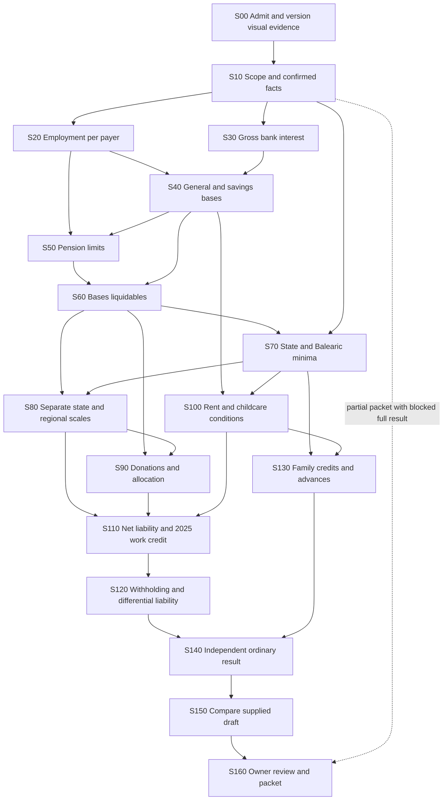

# Detailed tax requirements: 2025 Balearics

**Source-derived draft, 21 October 2026.** Product baseline 1.0 is owner-approved; rule transcriptions, field mappings and synthetic cases have not received independent tax review. This describes the wider required engine, with only the provisional C001 subset implemented as recorded below; no independent tax or model-quality result is claimed.

**Development update, 22 October:** [ADR 0004](../decisions/0004-development-before-tax-review.md) moves professional QA to the end. The [C001 working slice](../design/c001-working-slice.md) now implements a provisional subset with exact arithmetic, coverage/confirmation gates and export. This specification still covers the wider unimplemented profile. Pending review is retained explicitly; it is not a prerequisite for development.

## Versioned specification set

- [Public reference catalog](../../data/rules/2025/catalog.json) and [byte/hash manifest](../../data/rules/2025/manifest.json): fifteen retained public AEAT/BOE references, including exact selected consolidation editions and the original 2025 Modelo 100 published in 2026.
- [Calculation stages](../../data/rules/2025/calculation-stages.json): seventeen stages, dependencies, required facts, requirement IDs and stopping conditions.
- [AEAT field map](../../data/rules/2025/aeat-fields.json): 108 fields with semantic key, person/payer/annual/annex context, type and one-based physical source page.
- [Rule register](../../data/rules/2025/rule-register.json): 25 candidate rule contracts with source references, exact decimal-string transcriptions and explicit pending approval/rounding.
- [Review questions](../../data/rules/2025/review-questions.json): nine unresolved questions blocking affected branches, with no invented resolution or reviewer.

Each specification file binds the retained source manifest hash. A changed source set invalidates that binding until reviewed. A reference hash proves identity/integrity, not applicable law, faithful interpretation or tax correctness. See [retention and reuse](../../data/rules/2025/README.md).

## Calculation dependency map

This is a requirements dependency graph, not an implemented LangGraph workflow.

The machine-readable stages are the detailed contract, including dependencies omitted for readability. Partial review can export established facts/questions without completing this graph, while withholding a whole-return result. A missing AEAT draft permits independent calculation from complete confirmed facts; it prevents pretending to know a prior draft value.

## Facts and completeness contract

Every material fact has a visible source transcription, normalised value/unit/period, source/page/region or declared-human provenance, state and version. Distinguish absent, illegible, conflicting, claimed, confirmed, corrected, rejected and superseded. Unknown never means zero, false, no entitlement or no other income.

1. Establish residence, regional jurisdiction, accrual/period, ordinary regime, individual annual filing and any deceased/moved/rectification circumstances. Unvalidated branches require referral, not a guessed full-year default.
2. Collect every payer and certificate version. Separate ordinary cash, taxable in-kind valuation, payments on account, amounts recovered from the worker, genuine employer pension contributions and worker-elected payments. Reconcile repeated/corroborating amounts; a second certificate does not imply a second payment.
3. Record gross interest, withholding, net cash and beneficial ownership separately. Do not deduct ordinary bank-account fees as securities expenses or apply interest to the wrong owner.
4. Screen all other income/assets/imputations, prior losses/negative bases/excess pension contributions, other reliefs and prior deduction reversals. A material unsupported branch blocks the complete result while preserving useful partial work.
5. Collect each child's birth/adoption dates, relationship, cohabitation/entitlement, own income/filing, other claimant and allocation. Screen disability, ascendants, custody/maintenance, large/single-parent status, monthly benefit conditions and advance payments. A family classification must be a reviewed predicate, not the word “straightforward.”
6. Confirm exact facts/versions before a proposal or authoritative calculation uses them. Batch confirmation covers the displayed fact set only; model confidence, an issuer logo or a cited page cannot confirm a value or authenticate a document.

## Required stage behaviour and field anchors

| Stage | Detailed obligation | Principal field anchors |
|---|---|---|
| Employment | Derive payer gross/net, aggregate, apply the annual expense allowance once and distinguish the Article-20 reduction from the later liability credit | 0003-0008, 0024, 0012-0019, 0022, 0023, 0025 |
| Bank interest | Attribute gross taxable interest; preserve withholding independently | 0027, 0036, 0038, 0040, 0041 |
| Integration | Derive general/savings bases only after all material offset/history questions are answered | 0432, 0435, 0429, 0460 |
| Pension relief | Classify personal/employee/employer/flexible-pay amounts; apply contribution and reduction limits distinctly, employer relationships and statutory ordering; expose unused/excess amounts | 0465, 0438, 0426, 0427, 0467, 0468, 0492 |
| Bases liquidables | Apply allowed reductions without inventing an offset or negative base; record applied versus eligible amounts | 0500, 0505, 0510 |
| Minima | Compute state/regional taxpayer and descendant minima separately, with age/order/entitlement and shared allocation; allocate between general and savings bases | 0511-0514, 0519-0524 |
| Scales | Apply separate state/regional general and savings schedules and tax on minima; retain intermediate liabilities and prescribed rate truncation | 0528-0543, 0545, 0546 |
| Donations | Classify entity/activity, aggregate first tiers, establish recurrence per entity, cap bases, allocate state/regional shares and check applicable regional benefits | 0722-0725, 0552, 0553, 0900-0905 as applicable, 0913 |
| Rent | Establish qualifying category, actual payment/tenancy, household housing rights, income bases and incompatible entitlement; preserve Annex B.11 relationships | 1122-1130, 0907 |
| Childcare | Establish child/service/work periods, payment method, other claimants, caps/proration and interaction with other benefits | 0914 |
| Net liability | Apply reviewed component caps/order and increases; compute the distinct 2025 work deduction with its proportional cap | 0564, 0570, 0571, 0585-0587, 0414, 0595 |
| Withholding | Count cash withholding/in-kind payments/bank withholding once with ownership and period | 0596, 0597, 0609, 0610 |
| Refundable family benefits | Establish monthly maternity/nursery and other applicable family credits; reconcile advances without silently dropping a material entitlement | 0611-0613, 0660-0663 |
| Final and comparison | Derive the ordinary result; compare supplied field values with their own source/context. Map payment-document representation separately | 0670; Annex-II 0700 is distinct |

Ranges in this table are summaries, not an assertion that every intervening ID is supported. The JSON map lists exact selected fields and contextual branches. The official original form is [retained here](../../data/rules/2025/originals/boe-modelo-100-2025.pdf); field membership/page checks do not prove the semantic mapping correct.

## Specific implementation constraints

- All tax parameters and money use exact decimal strings/decimal arithmetic or integer minor units as appropriate. Resolve each legally required rounding/truncation stage before implementing a rule. No generic global rounding convention is accepted by default.
- State and Balearic scales/minima remain distinct. The Balearic increase is conditional; do not increase every taxpayer/child minimum or read the adjacent region from a shared manual page as Balearic law.
- Pension contribution limits and tax reduction limits are different. Employer and worker/flexible-pay classifications and employer income thresholds must not be inferred from a single total. Current-year unrelieved amounts remain visible even when prior-year carryforward processing is outside reviewed coverage.
- National donation first tiers apply to the legally defined aggregate; recurring treatment depends on the same entity/history. Regional eligibility and same-payment interactions require their own checks. A material donation category is supported or referred, never silently ignored.
- Regional deduction income gates use the relevant taxable bases, not gross salary. The third-sector donation limit in the candidate source is a base limit, not a credit cap. Rent/childcare source discrepancies remain open until reviewed.
- Post-2023 maternity eligibility and national nursery relief require their own monthly inputs and benefit/subsidy checks. Do not reuse obsolete employment/contribution caps or assume a regional childcare receipt alone establishes the final refund.
- No validated-release result uses an unapproved rule, unresolved material condition, unconfirmed fact or stale source/rule/case version. Explicit synthetic development may calculate the implemented source-derived provisional subset before professional QA. Missing facts and unsupported material conditions still block the affected result. Exact matching of a final total cannot excuse wrong intermediate fields.

## Review and release gate

The [synthetic source pack](../../evals/review/reviewer-guide.md) is development material for independent review. The reviewer must validate conditions, values, evidence, field context, intermediate calculations, alternatives and stopping outcomes. Tax labels remain separate under `evals/expected`, supplied only to the independent scorer/reviewer. Application/model inputs cannot read them.

The owner-selected [pilot targets](../product/acceptance.md) remain future targets: 30 files/100 pages, at least 95% correct sourced extraction, five minutes in at least 95% of attempts, and at least 20% less hands-on review time. No such experiment or quality claim exists. No live inference, private reference inspection, AEAT authentication/import/filing or cloud provisioning is authorised here.
